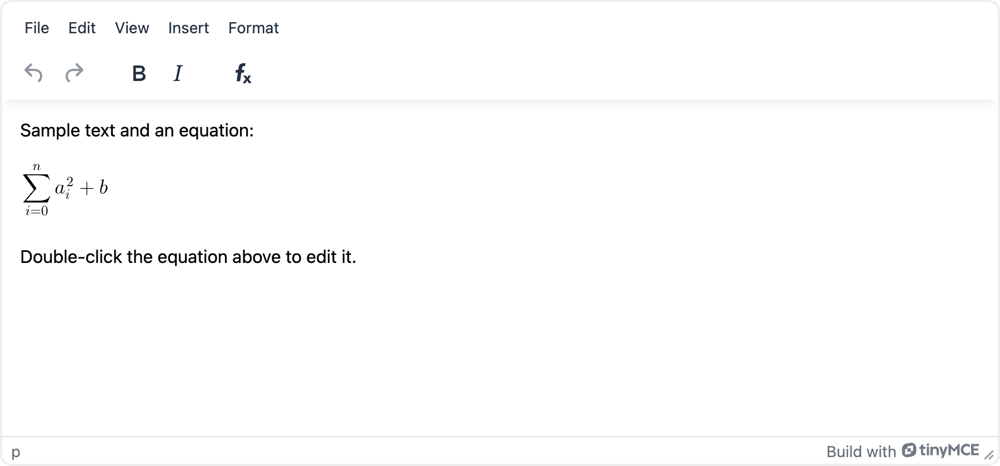
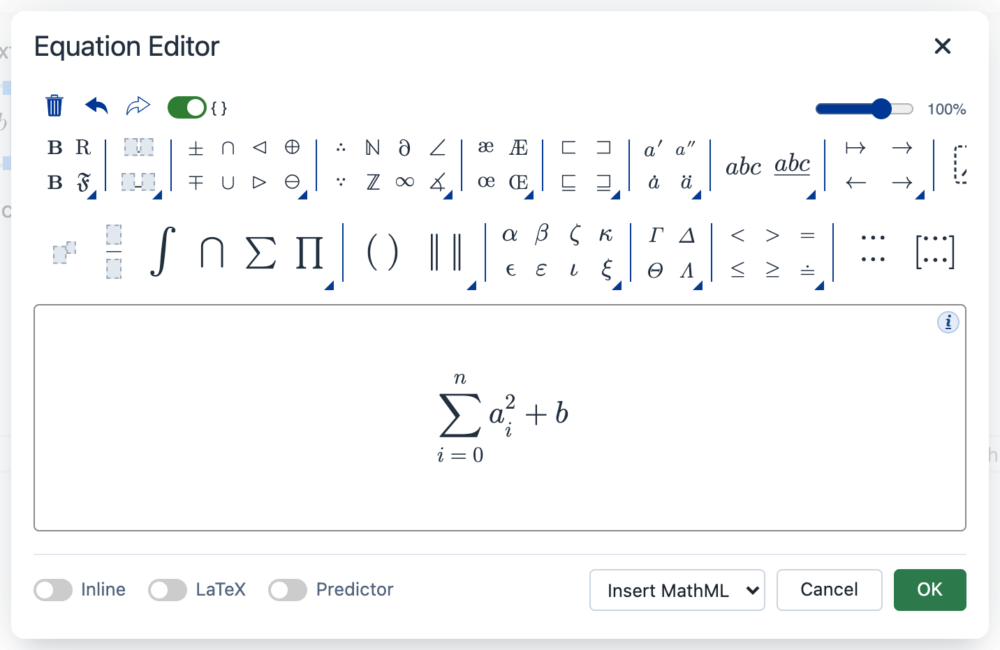

# fxEditor for TinyMCE 6 and 7

The fxEditor plugin for [TinyMCE](https://www.tiny.cloud) 6 and 7 adds an **fx** button to the
editor's toolbar. It opens fxEditor, CodeCogs' equation editor, in a dialog: a toolbar of symbols
and structures, a rendered maths view to build the equation in, and a LaTeX view that stays in
step with it. The author chooses how the equation goes into the document - as MathML (the
default) or as an SVG image - and double-clicking an inserted equation opens it for editing again.

The plugin is a single script, `eqneditor.js`, with no build step.

> **TinyMCE is not ours.** TinyMCE is the work of Tiny Technologies, Inc. and its contributors,
> under its own licence. The `vendor/` folder of this repository is a trimmed copy of TinyMCE 7,
> included unchanged so that `example.html` has an editor to load; it is not part of the npm
> package. Only `eqneditor.js` and `example.html` are CodeCogs' work. For TinyMCE itself, see
> [www.tiny.cloud](https://www.tiny.cloud).

## Screenshots



*The **fx** button on TinyMCE's toolbar, beside an equation in the document.*



*The fxEditor dialog, opened from the fx button.*

## Links

- [Documentation and live demo](https://fxplugins.codecogs.com/docs/tinymce.html)
- [Customise and download](https://fxplugins.codecogs.com/docs/tinymce.html#customise) - design
  the editor's toolbar, colour and sizes, and download it with an example page
- [All fxEditor plugins](https://fxplugins.codecogs.com)
- [fxEditor](https://fxeditor.codecogs.com)

## Installing from git

```bash
git clone https://github.com/willzyba/tinymce_v6.git
```

Copy `eqneditor.js` to your site - it is the only file you need. Load it after TinyMCE, and name
`eqneditor` in both `plugins` and `toolbar`:

```html
<script src="/path/to/tinymce/tinymce.min.js"></script>
<script src="/path/to/eqneditor.js"></script>
<script>
  tinymce.init({
    selector: '#mytextarea',
    plugins: 'eqneditor',
    toolbar: 'undo redo | bold italic | eqneditor',
    eqneditor_server: 'https://fxtex.codecogs.com',
    eqneditor_licence: 'your-licence-key',      // from fxeditor.codecogs.com/purchase - see below
    eqneditor_design: { colour: '#0f7a4d' }     // optional
  });
</script>
```

The equation editor itself is fetched from `https://fxtex.codecogs.com` the first time it is needed. The
plugin teaches TinyMCE to keep MathML, so there is no `valid_elements` list to maintain.

MathML needs a stylesheet on the page that displays it. The plugin loads it into TinyMCE's editing
area for you; on the page that finally shows your content, add:

```html
<link id="fxtex-style" rel="stylesheet" href="https://fxtex.codecogs.com/fxtex.css">
```

The `id` is the one fxTeX Pro looks for: on a page that also runs the editor, fxTeX Pro sees
the rules are already there and does not add a second copy.

To try the plugin straight from the clone, open `example.html`. It loads the copy of TinyMCE in
`vendor/`. Replace `{{EQN_SERVER}}` in it with `https://fxtex.codecogs.com` and `{{FXTEXPRO_KEY}}` with
your licence key.

Using Angular? See [fxplugins.codecogs.com/docs/angular.html](https://fxplugins.codecogs.com/docs/angular.html).

## Installing from npm

The plugin is being published to npm as `@codecogs/fxeditor-tinymce`. Until it appears there,
install it from git as above.

```bash
npm install @codecogs/fxeditor-tinymce
```

Then load it after TinyMCE, with the same configuration as above:

```html
<script src="node_modules/tinymce/tinymce.min.js"></script>
<script src="node_modules/@codecogs/fxeditor-tinymce/eqneditor.js"></script>
```

TinyMCE (6 or later) is a peer dependency: install it yourself.

## Licence key

Equations are rendered by fxTeX Pro, which needs a licence key for your domain. Without one,
equations show the reason they cannot render in place of the maths.

Get your licence key from [fxeditor.codecogs.com/purchase](https://fxeditor.codecogs.com/purchase).

The key goes in the `eqneditor_licence` option of `tinymce.init()`. The full set of options:

| Option | Default | |
|---|---|---|
| `eqneditor_licence` | | Your fxEditor licence key. Required. |
| `eqneditor_design` | | The editor's look: dialog width, height and scale, toolbar panels and size, colour, equation and markup sizes, undo/redo, how the dialog opens. Build one in [Customise and download](https://fxplugins.codecogs.com/docs/tinymce.html#customise). |
| `eqneditor_server` | `'https://fxtex.codecogs.com'` | Where the equation editor's own code is loaded from, as a URL (a bare host is taken as https). |
| `eqneditor_render_url` | `'https://fxtex.codecogs.com'` | The rendering service for equations inserted as images. Point it at a self-hosted fxTeX Server to keep equations inside your network. |
| `eqneditor_script_url` | from server | Full URL of the equation editor bundle. |
| `eqneditor_css_url` | from server | Full URL of the equation editor stylesheet. |
| `eqneditor_mathml_css_url` | from server | The MathML stylesheet (`fxtex.css`) loaded into the editing area's iframe. The page around it is not given a copy: fxTeX Pro adds its own when the dialog opens. With `inline: true` it is loaded into the page instead, under the id fxTeX Pro looks for. |

`eqneditor_insert_as` and `eqneditor_show_latex`, from earlier versions, are no longer read: the
author chooses MathML or an image in the dialog, and shows or hides the LaTeX with its toggle.

## Licence

Copyright (c) 2026 CodeCogs, Zyba Ltd.

The plugin (`eqneditor.js`) and the rest of this repository's own code are released under the
MIT licence - see [`LICENSE`](https://github.com/willzyba/tinymce_v6/blob/main/LICENSE).

TinyMCE is licensed separately by Tiny Technologies, Inc. The copy in `vendor/` (TinyMCE 7.9.3)
is under the GNU General Public License, version 2 or later - see
[`vendor/LICENSE.md`](https://github.com/willzyba/tinymce_v6/blob/main/vendor/LICENSE.md). fxEditor and fxTeX Pro are licensed by CodeCogs - see
[fxeditor.codecogs.com](https://fxeditor.codecogs.com).
